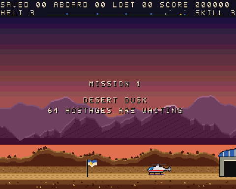

# ROTOR RESCUE

**An Amiga helicopter rescue game by Paul Ross Seibert.**

**© 2026 Desert Palms Software.**

<p align="center"></p>

<p align="center"></p>

<p align="center"><b><a href="demo/rotor-rescue.mp4">▶ Watch the 36-second gameplay video (with sound)</a></b></p>

Behind the border fence, 64 hostages are locked in four barracks. Fly your
rescue chopper in and blow the barracks open. Land near the people so they
can run aboard, then carry them home through tank fire, jets and floating
air mines. Land on the pad beside the hangar and they run inside to safety.
You have three choppers and three missions: Desert Dusk, Mountain Night and
Coastal Dawn.

## Download

| File | What it is |
|---|---|
| [**rotor-rescue.adf**](https://github.com/PaulSeibert/rotor-rescue/releases/latest/download/rotor-rescue.adf) | The game disk: a bootable Amiga floppy image. This is all you need to play. |
| [rotor-rescue-1.0.zip](https://github.com/PaulSeibert/rotor-rescue/releases/latest/download/rotor-rescue-1.0.zip) | The full release: the disk, the program for hard-disk installs, a README and the demo GIF |
| [rotor-rescue-demo.mp4](https://github.com/PaulSeibert/rotor-rescue/releases/latest/download/rotor-rescue-demo.mp4) | The gameplay video |

All versions are on the [Releases page](https://github.com/PaulSeibert/rotor-rescue/releases).

**Requirements:** an Amiga 500 with **1 MB of RAM** (512K chip + 512K
expansion), Kickstart 1.3 or later, PAL. It runs at 50 frames a second on a
stock 7 MHz 68000 with the original OCS chips. It's tested on Kickstart 1.3,
Kickstart 3.1 and the free AROS Kickstart replacement.

## Playing it

The ADF boots by itself, just like putting the floppy in a real Amiga.

- **WinUAE** (Windows) or **FS-UAE** (Windows, macOS, Linux): choose an
  Amiga 500 configuration with 512K chip + 512K slow RAM and PAL, put
  `rotor-rescue.adf` in drive DF0: and start it. Without a Kickstart ROM,
  both emulators can use their built-in AROS ROM, which the game runs on.
  Kickstart ROMs are sold by Cloanto in Amiga Forever.
- **THEA500 Mini:** copy `rotor-rescue.adf` to a FAT32 USB stick and pick
  it from the USB menu. Choose the A500 setup and PAL if it asks.
- **Amiberry** (Raspberry Pi and others): an A500 configuration, with the
  ADF in DF0:.
- **A real Amiga:** write the ADF to a floppy (with a Greaseweazle, or
  ADF-Copy), or copy it to a Gotek drive.

In an emulator, map your joystick or gamepad to port 2. Or play on the
keyboard: arrow keys and Space.

## Controls

A one-button joystick plays the whole game. A second button (CD32, Sega or
two-button pad) makes turning quicker.

| Input | Action |
|---|---|
| Stick up / down | Climb / descend. Descend all the way to land; push up to take off. |
| Stick left / right | Fly. The chopper speeds up and coasts with inertia. |
| Stick held against the way you face | The chopper turns, through facing the screen |
| Fire, facing left or right | Cannon: hits jets, mines, tanks and barracks (and people, so careful) |
| Down + Fire in the air | Turn to face the screen |
| Fire, facing the screen | Drop a bomb: tanks and barracks |
| Fire 2 (second button) | Turn: left → front → right → front … |
| Keyboard | Arrows, Space = fire, X = turn, P = pause, M = music on/off, Esc = quit |
| Ctrl+L, then 0-5 | Difficulty (see below), on the title screen or during play |

## Difficulty

Press **Ctrl+L**, then a number key within two seconds. The setting shows at
the right of the score bar and stays until you change it.

| Key | Setting |
|---|---|
| 1 | Easiest: fewer tanks, slower and less accurate shells, jets and mines come later |
| 2 | Easy |
| 3 | **Normal** (the default) |
| 4 | Hard: more tanks, faster and sharper shells, jets and mines sooner |
| 5 | Hardest: jets from the start |
| 0 | **GODMODE**: plays like Normal, but nothing can destroy the chopper (hits just explode). For testing; it doesn't set the hi-score. |

## How to play

- Shoot a barracks twice, or bomb it once, and it bursts open. Its 16
  hostages come out.
- Land near them and they run to the chopper. It holds 16 at most. Don't
  land on anyone.
- Fly back to the base on the far right and land on the pad. Each person who
  reaches the hangar counts as **SAVED**.
- Tanks shell a chopper that's low or on the ground, so don't sit still for
  long.
- Jets join in after your first trip home, and air mines after the second.
- One hit and the chopper goes down with everyone aboard.
- A mission ends when all 64 are saved or lost. The game ends when the last
  chopper is gone, and you get a rank for everyone you saved.

The HUD shows SAVED / ABOARD / LOST and the score. Below them are the
choppers left and a radar of the whole battlefield: barracks (blue closed,
red open), people, tanks, jets, mines, the base and you (yellow).

## What the Amiga is doing

- **The Desert Palms Software logo at boot.** A 288×242 picture in 16
  colours, loaded from the floppy and freed again after it's shown. The copper
  reloads 4 of the colours on every line where the picture changes, so the
  shield's sunset stripes and the purple horizon keep their gradients: about
  320 different colours in one picture. It fades in and out by rewriting the
  colour values in its own copper lists. Fire skips it.

- **Dual playfield.** Playfield 2 holds three looping parallax bands, each
  with its own fine scroll and palette set by the copper: far mountains at
  ¼ speed, hills at ½ and the ground at 1:1. Playfield 1 is a
  double-buffered layer where the blitter draws every building, person,
  tank, jet, shot and explosion from a queue while the CPU runs the game.
- **Copper.** A sky gradient for each mission, palette changes between the
  bands, and a split between the HUD and the play area. The top 120 lines
  run with 3 bitplanes instead of 6 to leave more of the bus to the CPU.
- **Sprites.** The chopper is a 32-pixel-wide, 15-colour attached hardware
  sprite (four channels), with tilt, turn, front and wreck poses and an
  animated rotor.
- **Paula.** One channel plays a looped rotor chop whose pitch follows your
  airspeed. Sound effects use two more. The title theme, the
  mission-complete fanfare and the game-over tune use synthesized sampled
  instruments (`sound/tools/make_samples.py`).

## Building

The game is written in C, with the Amiga Game Kit (`agk`) and the
[ACE](https://github.com/AmigaPorts/ACE) engine. `src/logic.c` holds the game
rules (portable C, unit-tested on a PC), `src/main.c` the Amiga side, and
`src/splash.c` the logo screen.

```sh
agk unit      # game rules on the host (tests/unit)
agk build     # build/first.adf, a bootable floppy (the project folder is called first)
agk test      # emulator tests on A500 (KS 1.3, KS 3.1, AROS)
agk play      # play it in FS-UAE
agk release && python3 tools/finish_release.py   # the zip for Aminet / itch.io (build/release/)
agk record demo/showcase.agk -o build/demo.mp4 --readme --gif demo/rotor-rescue.gif --gif-start 8.6 --gif-seconds 12   # this README's GIF and video (needs ffmpeg)
cp build/demo.mp4 demo/rotor-rescue.mp4
```

All the art is made by scripts and all the music samples by
`sound/tools/make_samples.py`, so every asset can be regenerated from
source. `art/tools/draw.py` draws the game's graphics, and
`art/tools/make_dps_logo.py` converts the Desert Palms Software logo
(`art/src/desert_palms_logo_source.png`) into `disk/dpslogo.bin`.

## Credits

**Rotor Rescue** © 2026 Desert Palms Software. All rights reserved.

Design, code, graphics and music: **Paul Ross Seibert**.
It's an original game in the classic 8-bit helicopter-rescue genre.

Built with:
- the [ACE](https://github.com/AmigaPorts/ACE) game engine, including its
  ProTracker player (Mozilla Public License 2.0)
- the Amiga Game Kit runtime (MIT License)
