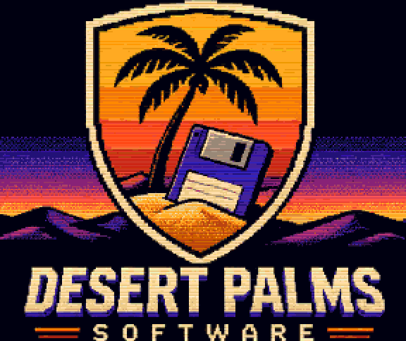

# ROTOR RESCUE

**An Amiga helicopter rescue game by Paul Ross Seibert.**

**© 2026 Desert Palms Software.**

<p align="center"></p>

<p align="center"></p>

<p align="center"><b><a href="demo/rotor-rescue.mp4">▶ Watch the 36-second gameplay video (with sound)</a></b></p>

Behind the border fence, 64 hostages are locked in four barracks. Fly your
rescue chopper in and blow the barracks open. Land near the people so they
can run aboard, then carry them home through tank fire, jets and floating
air mines. Land on the pad beside the hangar and they run inside to safety.
You have three choppers and three missions: Desert Dusk, Mountain Night and
Coastal Dawn.

## Download

| File | What it is |
|---|---|
| [**rotor-rescue.adf**](https://github.com/PaulSeibert/rotor-rescue/releases/latest/download/rotor-rescue.adf) | The game disk: a bootable Amiga floppy image. This is all you need to play. |
| [rotor-rescue-1.0.zip](https://github.com/PaulSeibert/rotor-rescue/releases/latest/download/rotor-rescue-1.0.zip) | The full release: the disk, the program for hard-disk installs, a README and the demo GIF |
| [rotor-rescue-demo.mp4](https://github.com/PaulSeibert/rotor-rescue/releases/latest/download/rotor-rescue-demo.mp4) | The gameplay video |

All versions are on the [Releases page](https://github.com/PaulSeibert/rotor-rescue/releases).

**Requirements:** an Amiga 500 with **1 MB of RAM** (512K chip + 512K
expansion), Kickstart 1.3 or later, PAL. It runs at 50 frames a second on a
stock 7 MHz 68000 with the original OCS chips. It's tested on Kickstart 1.3,
Kickstart 3.1 and the free AROS Kickstart replacement. On an **Amiga 1200**
(AGA chips) it shows a 24-bit sky and a 224-colour title logo; see
[On an Amiga 1200](#on-an-amiga-1200).

## Playing it

The ADF boots by itself, just like putting the floppy in a real Amiga.

- **WinUAE** (Windows) or **FS-UAE** (Windows, macOS, Linux): choose an
  Amiga 500 configuration with 512K chip + 512K slow RAM and PAL, put
  `rotor-rescue.adf` in drive DF0: and start it. Without a Kickstart ROM,
  both emulators can use their built-in AROS ROM, which the game runs on.
  Kickstart ROMs are sold by Cloanto in Amiga Forever.
- **THEA500 Mini:** copy `rotor-rescue.adf` to a FAT32 USB stick and pick
  it from the USB menu. Choose the A500 setup and PAL if it asks.
- **Amiberry** (Raspberry Pi and others): an A500 configuration, with the
  ADF in DF0:.
- **A real Amiga:** write the ADF to a floppy (with a Greaseweazle, or
  ADF-Copy), or copy it to a Gotek drive.

In an emulator, map your joystick or gamepad to port 2. Or play on the
keyboard: arrow keys and Space.

## Controls

A one-button joystick plays the whole game. A second button (CD32, Sega or
two-button pad) makes turning quicker.

| Input | Action |
|---|---|
| Stick up / down | Climb / descend. Descend all the way to land; push up to take off. |
| Stick left / right | Fly. The chopper speeds up and coasts with inertia. |
| Stick held against the way you face | The chopper turns, through facing the screen |
| Fire, facing left or right | Cannon: hits jets, mines, tanks and barracks (and people, so careful) |
| Fire, facing left or right | The cannon: taps, a held fire, any volley (it never turns into bombs) |
| Hold Down for a second (no fire), then Fire | Turn to face the screen: the bomb stance |
| Fire, facing the screen | Drop a bomb: tanks and barracks |
| Up + Fire, facing the screen | Turn back to the cannon |
| Left / right, facing the screen | A quick sidestep, leaning into the move: jink between bombs and shells |
| Fire 2 (second button) | Turn: left → front → right → front … |
| Keyboard | Arrows, Space = fire, X = turn, P = pause, M = music on/off, Esc = quit |
| Ctrl+L, then 0-5 | Difficulty (see below), on the title screen or during play |
| Fire on the mission card | Skip it and start flying |
| Initials (a new high score) | Stick up / down: the letter; Fire: the next; left: back one |

## Difficulty

Press **Ctrl+L**, then a number key within two seconds. The setting shows at
the right of the score bar and stays until you change it.

| Key | Setting |
|---|---|
| 1 | Easiest: fewer tanks, slower and less accurate shells, jets and mines come later |
| 2 | Easy |
| 3 | **Normal** (the default) |
| 4 | Hard: more tanks, faster and sharper shells, jets and mines sooner |
| 5 | Hardest: jets from the start |
| 0 | **GODMODE**: plays like Normal, but nothing can destroy the chopper (hits just explode). For testing; it doesn't set the hi-score. |

## How to play

- Shoot a barracks twice, or bomb it once, and it bursts open. Its 16
  hostages come out.
- Land near them and they run to the chopper. It holds 16 at most. Don't
  land on anyone.
- Fly back to the base on the far right and land on the pad. Each person who
  reaches the hangar counts as **SAVED**.
- Tanks shell a chopper that's low or on the ground, so don't sit still for
  long. A tank about to fire stops, swings its barrel up and flashes for a
  moment (16 frames on Normal) before the shell leaves: that's your cue.
- Jets join in after your first trip home, and air mines after the second. You hear a jet
  and see it on the radar before it's on screen, mostly coming from ahead, and it holds
  its fire for a moment after it appears. A jet that is about to fire glows at the nose and
  exhaust (16 frames on Normal) and only ever fires while it is wholly on screen.
- The first hit **damages** the chopper: it smokes, flies about a fifth slower, the HUD says
  DAMAGED and it blinks for two seconds in which nothing can hurt it. Everyone aboard is kept.
  Land on the base pad and it is repaired. A second hit while damaged brings it down with
  everyone aboard.
- Only the first 10 tanks you destroy in a mission score (50 each; the HUD says QUOTA 10 when
  you reach it). Later tanks still shoot.
- A mission ends when all 64 are saved or lost. The game ends when the last
  chopper is gone, and you get a rank for everyone you saved.
- Each mission opens with a card: which of the three it is, a map of the
  battlefield (the enemy ground in red, the four barracks, the fence, our pad
  and hangar, and an arrow where you are) and what's out there this time.
- A score in the top five goes into the **hall of fame** with your initials,
  the mission you reached and your rank. It's saved to the floppy (a small
  file, `rrscores`) and read back at boot. On a write-protected disk the table
  still shows, it just isn't saved, and the game says so.
- Leave the title alone and it shows the hall of fame, then a demo of the
  first trip (DEMO in the score bar). Fire ends it.

The HUD shows SAVED / ABOARD / LOST and the score. Below them are the
choppers left and a radar of the whole battlefield: barracks (blue closed,
red open), people, tanks, jets, mines, the base and you (yellow).

## What the Amiga is doing

- **The Desert Palms Software logo at boot.** A 288×242 picture in 16
  colours, loaded from the floppy and freed again after it's shown. The copper
  reloads 4 of the colours on every line where the picture changes, so the
  shield's sunset stripes and the purple horizon keep their gradients: about
  320 different colours in one picture. It fades in and out by rewriting the
  colour values in its own copper lists. Fire skips it.
- **The ROTOR RESCUE title logo.** A 192×129 picture in 16 colours over the
  sky's copper gradient, loaded from the floppy. For its lines the title's own
  copper list switches the display to a single 4-plane playfield that fetches
  just the logo's 12 words, and reloads 8 of its colours on every line, so
  ROTOR's blue and RESCUE's gold keep their gradients: about 800 colour
  changes down the picture. Below it the copper switches back to the dual
  playfield for the credits and the land.

- **Dual playfield.** Playfield 2 holds three looping parallax bands, each
  with its own fine scroll and palette set by the copper: far mountains at
  ¼ speed, hills at ½ and the ground at 1:1. Playfield 1 is a
  double-buffered layer where the blitter draws every building, person,
  tank, jet, shot and explosion from a queue while the CPU runs the game.
- **Copper.** A sky gradient for each mission, palette changes between the
  bands, and a split between the HUD and the play area. The top 120 lines
  run with 3 bitplanes instead of 6 to leave more of the bus to the CPU.
  The sky is line-dithered, as in Fire & Ice: where the gradient falls
  between two of the A500's 4096 colours, the lines alternate between them,
  so the eye sees the half step. That's twice the shades for a MOVE a line
  (`tools/checksky.py` checks a screenshot line by line).
- **Sprites.** The chopper is a 32-pixel-wide, 15-colour attached hardware
  sprite (four channels), with tilt, turn, front and wreck poses and an
  animated rotor.
- **Paula.** One channel plays a deep blade thump, a looped whop-whop-whop whose rate
  follows your speed and climb and spins up at take-off. Sound effects use two more. The title theme, the
  mission-complete fanfare and the game-over tune use synthesized sampled
  instruments (`sound/tools/make_samples.py`).

## On an Amiga 1200

The same disk runs on an A1200. At startup the game reads Lisa's chip ID
(DENISEID, `$F8` on AGA), and when it finds the AGA chipset it switches on the
following. The A500 game is unchanged.

- **A 24-bit sky.** On the A500 each mission's sky is a copper gradient in
  12-bit colour: about 14 bands, each about a dozen lines tall, line-dithered
  into half steps. On AGA the
  copper writes the sky colour in 24 bits on all 172 sky lines. It writes
  COLOR00's high nibbles, sets BPLCON3's LOCT bit, writes the low nibbles,
  then clears LOCT again. That's four MOVEs a line, and the sunset, night and
  dawn skies fade smoothly with no visible steps, in play and on the title.
- **The title logo in 224 colours.** The ROTOR RESCUE logo is drawn again
  from the same source picture (`art/tools/make_title_logo8.py`) in
  8 bitplanes, with 224 colours of 24 bits each and no dithering. It's
  loaded from the floppy (`titlelogo8.bin`, 19 KB packed). The title's copper
  list loads its palette into colour registers 32-255 in the vertical blank,
  in banks of 32, high nibbles and then low. Pens 0-31 stay the game's, so
  nothing has to be put back after the logo's lines. For the logo's
  130 lines the copper switches to 8 planes at normal (1x) fetch, then back
  to the game's 3 planes.
- **OCS registers kept OCS.** Each copper list sets FMODE to 0, BPLCON3 to
  `$0C00` (playfield 2's colours from 8) and BPLCON4 to `$0011` (sprites in
  colours 16-31). Kickstart 3.1 leaves BPLCON3 at 0. In version 1.0 that gave
  the parallax bands the wrong colours on an A1200.
- **Quarter-pixel parallax.** AGA's BPLCON1 scrolls in 35 ns steps, a
  quarter of a lores pixel (bits 13-12 for playfield 2). The clouds,
  mountains and hills take their fine scroll in quarter pixels, so at full
  speed the mountains move 0.75 px every frame and the hills 1.5, instead of
  the A500's 0, 1, 1, 1 and 1, 2, 1, 2. (vAmiga ignores those bits when it
  draws, so the emulator's screenshots show whole pixels; `tests/parallax.agk`
  checks the values the copper gets.)
- Colours 29-31 (the sky's wisps and stars) are written by the copper on AGA
  rather than by the CPU. A CPU colour write that lands between a sky
  line's two LOCT MOVEs would set only the low nibbles.

Two small differences show in the emulator's A1200 (vAmiga). The radar's
dark inset starts and ends 1 pixel later, because a copper colour change in
the middle of a line shows 1 pixel later there than on the A500. A sky wisp
near the top left also shows that the A500 doesn't display. Version 1.0
does both on the A1200 too. The A1200 version hasn't been tried on real
hardware yet.

`tools/checkaga.py` checks an A1200 screenshot pixel by pixel in 24-bit colour:
the sky on every line against `logicSkyColor24()`, and the logo against
`disk/titlelogo8.bin`. The tests run on the A1200 too (`a1200` profile, its own
goldens in `tests/golden/*/a1200/`).

## Building

The game is written in C, with the Amiga Game Kit (`agk`) and the
[ACE](https://github.com/AmigaPorts/ACE) engine. `src/logic.c` holds the game
rules (portable C, unit-tested on a PC), `src/main.c` the Amiga side, and
`src/splash.c` the logo screen.

```sh
agk unit      # game rules on the host (tests/unit)
agk build     # build/first.adf, a bootable floppy (the project folder is called first)
agk test      # emulator tests on A500 (KS 1.3, KS 3.1, AROS) and A1200 (AGA)
~/amiga-tools/venv-img/bin/python tools/checkaga.py build/agk/a1200/boot/title.screen.png --mission 0 --logo --last-line 161   # the A1200's sky and logo, exactly
agk play      # play it in FS-UAE
agk release && python3 tools/finish_release.py   # the zip for Aminet / itch.io (build/release/)
agk record demo/showcase.agk -o build/demo.mp4 --readme --gif demo/rotor-rescue.gif --gif-start 8.6 --gif-seconds 12   # this README's GIF and video (needs ffmpeg)
cp build/demo.mp4 demo/rotor-rescue.mp4
```

The sprites and parallax bands are text art in `art/*.txt` (the Desert Palms
art pilot's approved set; `art/tools/draw.py` is the old drawing code, kept for
reference, and only writes the palettes), and all the music samples are made by
`sound/tools/make_samples.py`. `art/tools/make_mountain_caps.py` points every
summit of `art/mountains.txt` (nothing touches the band's top edge) and
`art/tools/make_title_mtn.py` cuts the title's mountain strip from it, fading
into the haze at its foot. Also
`art/tools/make_dps_logo.py` converts the Desert Palms Software logo
(`art/src/desert_palms_logo_source.png`) into `disk/dpslogo.bin`, and
`art/tools/make_title_logo.py` the title logo
(`art/src/rotor_rescue_title_source.png`) into `disk/titlelogo.bin`
(preview: `art/title_logo_amiga.png`), and `art/tools/make_title_logo8.py`
the A1200's version into `disk/titlelogo8.bin` (preview:
`art/title_logo8_amiga.png`).

## Credits

**Rotor Rescue** © 2026 Desert Palms Software. All rights reserved.

Design, code, graphics and music: **Paul Ross Seibert**.
It's an original game in the classic 8-bit helicopter-rescue genre.

Built with:
- the [ACE](https://github.com/AmigaPorts/ACE) game engine, including its
  ProTracker player (Mozilla Public License 2.0)
- the Amiga Game Kit runtime (MIT License)
